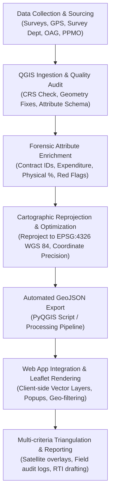

# Complete End-to-End Workflow: QGIS Geospatial Data Preparation to Interactive Web App Integration

This document outlines the standard operating procedure (SOP) and complete engineering pipeline for acquiring, cleaning, standardizing, and exporting geospatial data in **QGIS** (Quantum Geographic Information System) to web-optimized **GeoJSON (EPSG:4326)**, followed by seamless integration into **Kapilvastu Transparency Watch** or any investigative research platform.

---

## Workflow Architecture Overview



---

## Phase 1: Data Collection & Primary Acquisition

### 1. Spatial Boundary & Basemap Datasets
- **Administrative Boundaries (Ward, Municipality, District)**:
  - Source: Official Survey Department of Nepal (*Napi Bibhag*) or Ministry of Federal Affairs and General Administration (MoFAGA).
  - Common Native Formats: ESRI Shapefile (`.shp`, `.shx`, `.dbf`, `.prj`), GeoPackage (`.gpkg`).
  - Native Coordinate Reference System (CRS): Commonly projected in **Nepal Modified UTM (MUTM)** or **Everest 1830 (EPSG:6207 / EPSG:5233)**.
- **Project Site Geocoding**:
  - Source: Field handheld GPS coordinates (WGS 84 lat/long), e-GP tender notices, or on-site geotagged photos.
  - Geometry Types:
    - **Point**: Deep tubewells, school buildings, municipal administrative blocks, health posts.
    - **LineString**: Road paving, embankment revetments, irrigation canals, drainage networks.
    - **Polygon**: Ward administrative areas, buffer preservation zones (e.g., Tilaurakot Archaeological Buffer).

---

## Phase 2: QGIS Setup, Quality Audit & Data Cleansing

### 1. Initial QGIS Project Setup
1. Launch **QGIS 3.28+ (LTR)**.
2. Go to **Project > Properties > CRS** and set the Project CRS to **EPSG:4326 - WGS 84**.
3. Under **Browser Panel**, connect to your local working directory:
   ```
   clean-repo/gis_data/
   ```

### 2. Validating & Fixing Geometries
Corrupted polygon rings or self-intersections will fail web geo-parsing:
1. Run **Processing Toolbox > Vector Geometry > Check Validity**.
2. Run **Processing Toolbox > Vector Geometry > Fix Geometries** to eliminate duplicate nodes and non-closed rings.
3. Eliminate duplicate vertices: **Simplify** with a tolerance of `0.00001` degrees (approx. 1 meter).

### 3. Schema Standardization & Attribute Alignment
Every layer must match the application's forensic schema to support automated indicators and filtering:

| Attribute Field | QGIS Field Type | Description / Example | Required for App? |
|---|---|---|---|
| `id` | String (25) | Unique Package ID (`KV-NCB-208101`) | **Yes** (Primary Key) |
| `egp_id` | String (30) | PPMO e-GP Portal ID (`PPMO-EGP-2081-94812`) | Optional |
| `name` | String (100) | Public Project Name / Description | **Yes** |
| `ward` | Integer (2) | Ward Number (`1` to `12`) | **Yes** (Filtering) |
| `cat` | String (50) | Sector Category (`Blacktopped Roads & Culverts`) | **Yes** (Filtering) |
| `fy` | String (10) | Nepali Fiscal Year (`2081/82`) | **Yes** |
| `contractor`| String (80) | Awarded Vendor Name | **Yes** (Cartel Analysis) |
| `pan` | String (15) | Contractor PAN Number (`301928344`) | Highly Recommended |
| `budget_est`| Double (10,2) | Approved Estimate (NPR Millions) | **Yes** |
| `contract_val`| Double (10,2)| Awarded Contract Amount (NPR Millions) | **Yes** |
| `spent_val` | Double (10,2) | Actual Disbursed Outlay (NPR Millions) | **Yes** |
| `physical_prog`| Integer (3) | Verified/Reported Progress (`0-100%`) | **Yes** (Risk Scoring) |
| `bidders_count`| Integer (2) | Number of competing bidders received | Recommended |
| `delay_days`| Integer (4) | Project delay in days past scheduled handover | Recommended |
| `amendments_count`| Integer (2)| Number of variation orders granted | Recommended |

> **Pro Tip**: Use Field Calculator in QGIS to auto-calculate fields:
> - Calculate `spent_ratio = ("spent_val" / "contract_val") * 100`
> - Calculate `prog_gap = ("spent_val" / "contract_val" * 100) - "physical_prog"`

---

## Phase 3: Automated PyQGIS Processing & GeoJSON Export Pipeline

Rather than manually exporting layers one by one, use the following automated Python script directly in the **QGIS Python Console** (`Ctrl + Alt + P`):

```python
"""
PyQGIS Automation Pipeline for Kapilvastu Transparency Watch
Executes: Topology Validation -> Reprojection -> Coordinate Rounding -> Optimized GeoJSON Export
"""

from qgis.core import (
    QgsProject,
    QgsVectorLayer,
    QgsCoordinateReferenceSystem,
    QgsVectorFileWriter,
    QgsFeatureRequest
)
import processing
import os

# Set Paths
BASE_DIR = "c:/Users/BishnuSinghRayamajhi/OneDrive/Desktop/sdrok2080/clean-repo"
OUTPUT_DIR = os.path.join(BASE_DIR, "exported_geojson")
os.makedirs(OUTPUT_DIR, exist_ok=True)

# List of Layers in QGIS Project to Process
layers_to_export = [
    {"layer_name": "Kapilvastu_Ward_Boundaries", "out_name": "kapilvastu_wards.geojson"},
    {"layer_name": "Kapilvastu_Infrastructure_Contracts", "out_name": "kapilvastu_contracts.geojson"}
]

print("=== Starting QGIS Export Pipeline ===")

for item in layers_to_export:
    lyr_match = QgsProject.instance().mapLayersByName(item["layer_name"])
    if not lyr_match:
        print(f"[-] Warning: Layer '{item['layer_name']}' not found in active project.")
        continue
    
    layer = lyr_match[0]
    out_path = os.path.join(OUTPUT_DIR, item["out_name"])
    
    # Step 1: Geometry Repair
    fixed = processing.run("native:fixgeometries", {
        'INPUT': layer,
        'OUTPUT': 'memory:'
    })['OUTPUT']
    
    # Step 2: Reproject to WGS 84 (EPSG:4326)
    reprojected = processing.run("native:reprojectlayer", {
        'INPUT': fixed,
        'TARGET_CRS': QgsCoordinateReferenceSystem('EPSG:4326'),
        'OUTPUT': 'memory:'
    })['OUTPUT']
    
    # Step 3: Write to GeoJSON with 5-decimal coordinate rounding (precision ~1.1 meters)
    save_options = QgsVectorFileWriter.SaveVectorOptions()
    save_options.driverName = "GeoJSON"
    save_options.fileEncoding = "UTF-8"
    save_options.layerOptions = [
        "COORDINATE_PRECISION=5",
        "WRITE_BBOX=YES"
    ]
    
    err, msg = QgsVectorFileWriter.writeAsVectorFormatV3(
        reprojected,
        out_path,
        QgsProject.instance().transformContext(),
        save_options
    )
    
    if err == QgsVectorFileWriter.NoError:
        print(f"[+] Successfully exported: {item['out_name']} ({reprojected.featureCount()} features)")
    else:
        print(f"[-] Error exporting {item['out_name']}: {msg}")

print("=== Pipeline Complete! Ready for App Ingestion ===")
```

---

## Phase 4: Application Integration & Interactive Map Visualization

The web platform ([KapilvastuTransparencyWatch.html](file:///c:/Users/BishnuSinghRayamajhi/OneDrive/Desktop/sdrok2080/clean-repo/KapilvastuTransparencyWatch.html)) supports two direct integration paths:

### Method A: Direct In-Browser Ingestion (Zero Backend / Offline Private Vault)
1. Open the application in any modern browser.
2. Click **"⬆️ Ingest Datasets"** in the top navigation bar (or navigate to tab `Data Ingestion & QGIS`).
3. Under **"2. Ingest Spatial Layers (Shapefile / Raster)"**:
   - Drag and drop your `.geojson` or `.zip` (containing `.shp`, `.dbf`, `.prj`).
4. The file is parsed instantly via client-side Web Workers (`shpjs` / native GeoJSON parser).
5. Switch to **"GIS & Satellite Verification"** tab: the new layer appears automatically in Leaflet's layer switch box and is dynamically styled.

### Method B: Native Static Code Integration
To permanently bundle the QGIS GeoJSON layer into the application codebase:

```javascript
// Example: Adding Ward Boundary GeoJSON into the Leaflet Map Engine
fetch("exported_geojson/kapilvastu_wards.geojson")
  .then(res => res.json())
  .then(wardGeoJson => {
    var wardLayer = L.geoJSON(wardGeoJson, {
      style: function(feature) {
        return {
          color: "#3b82f6",
          weight: 2,
          opacity: 0.8,
          fillColor: "#1e3a8a",
          fillOpacity: 0.15
        };
      },
      onEachFeature: function(feature, layer) {
        var p = feature.properties;
        layer.bindTooltip("<b>Ward " + p.ward + "</b>: " + (p.name || ""), { sticky: true });
        layer.on("click", function() {
          // Cross-filter application state to this ward
          filterByWard(p.ward);
        });
      }
    }).addTo(map);

    // Register in map layer switcher
    layerControl.addOverlay(wardLayer, "Ward Boundaries (Official Survey)");
  });
```

---

## Phase 5: Verification & Triangulation Checklist

Before publishing research findings based on GIS-extracted layers:
- [ ] **Dual Ground-Truth Check**: Verify GPS points against Esri Satellite Basemap to confirm the point does not fall in water bodies or incorrect administrative wards.
- [ ] **Coordinate Sanity Check**: Confirm all coordinates fall within Kapilvastu bounds (Latitude: `27.40` to `27.80` N, Longitude: `82.80` to `83.25` E).
- [ ] **Red Flag Corroboration**: Cross-examine flagged projects with OAG statutory audit observations (Beruju) and citizen field logs.
- [ ] **RTI Filing**: Use the built-in **RTI Request Generator** to demand official Measurement Books (MB) from Kapilvastu Municipality for any package showing `>20%` financial vs. physical disparity.
